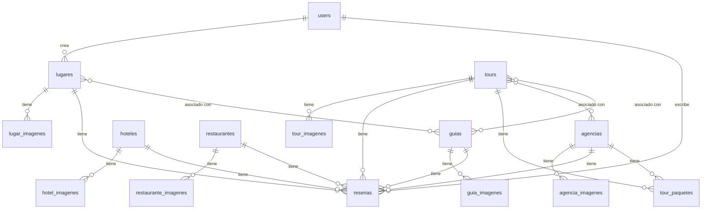

# DOCUMENTACIÓN TÉCNICA — TurismoHuila

**Fecha de análisis:** 22 de julio de 2026
**Metodología:** Análisis estático del código fuente
**Alcance:** Todos los archivos del proyecto

---

## 1. DESCRIPCIÓN DEL PROYECTO

### Objetivo
Sistema de gestión y promoción turística del departamento del Huila (Colombia).

### Problema que resuelve
- Centraliza información turística en un directorio digital
- Permite gestión de contenido con roles diferenciados (admin/turista)
- Sistema de reseñas y calificaciones para servicios turísticos
- Búsqueda y filtrado por municipio

### Usuarios del sistema
- **Admin:** Gestiona contenido (lugares, hoteles, restaurantes, tours, guías, agencias)
- **Turista:** Consulta información y deja reseñas

**Evidencia:**
- `app/Models/User.php` líneas 34-42: Métodos `esAdmin()` y `esTurista()`
- `routes/web.php` línea 21: Middleware `rol:admin` para rutas de gestión
- `routes/web.php` línea 52: Middleware `auth` para rutas de turista

---

## 2. TECNOLOGÍAS

### Framework
- **Laravel:** ^13.8 (`composer.json` línea 10)
- **PHP:** ^8.3 (`composer.json` línea 9)

### Frontend
- **Blade Templates:** Motor de plantillas
- **Tailwind CSS:** ^3.1.0 (`package.json` línea 17)
- **Vite:** ^8.0.0 (`package.json` línea 18)
- **Bootstrap:** ^5.3.8 (`package.json` línea 23)
- **Alpine.js:** ^3.4.2 (`package.json` línea 12)
- **Vue.js:** ^3.5.38 (`package.json` línea 24) - Dependencia pero no se evidencia uso en código analizado

### Base de datos
- **MySQL:** (evidencia en migraciones)
- **SQLite:** Configurado en `.env.example` línea 23

### Dependencias Composer
- `laravel/framework`: ^13.8
- `laravel/tinker`: ^3.0
- `laravel/breeze`: ^2.4 (autenticación)
- `barryvdh/laravel-ide-helper`: ^3.7 (desarrollo)
- `fakerphp/faker`: ^1.23 (testing)
- `laravel/pail`: ^1.2.5 (logs)
- `laravel/pint`: ^1.27 (formato código)
- `phpunit/phpunit`: ^12.5.12 (testing)

### Dependencias NPM
- `@tailwindcss/forms`: ^0.5.2
- `@tailwindcss/vite`: ^4.0.0
- `laravel-vite-plugin`: ^3.1
- `postcss`: ^8.4.31
- `autoprefixer`: ^10.4.2
- `concurrently`: ^9.0.1
- `@popperjs/core`: ^2.11.8
- `@vitejs/plugin-vue`: ^6.0.7

---

## 3. ARQUITECTURA

### Patrón
- **MVC (Modelo-Vista-Controlador)**
- Organización por módulos funcionales
- Componentes Blade reutilizables

### Estructura de carpetas

```
app/
├── Concerns/
│   └── HasGalleryImages.php (trait)
├── Http/
│   ├── Controllers/
│   │   ├── Auth/
│   │   │   ├── AuthenticatedSessionController.php
│   │   │   └── RegisteredUserController.php
│   │   ├── LugarController.php
│   │   ├── HotelController.php
│   │   ├── RestauranteController.php
│   │   ├── TourController.php
│   │   ├── GuiaController.php
│   │   ├── AgenciaController.php
│   │   ├── ResenaController.php
│   │   └── ProfileController.php
│   └── Middleware/
│       └── VerificarRol.php
├── Models/
│   ├── User.php
│   ├── Lugar.php
│   ├── Hotel.php
│   ├── Restaurante.php
│   ├── Tour.php
│   ├── Guia.php
│   ├── Agencia.php
│   ├── Resena.php
│   ├── TourPaquete.php
│   ├── LugarImagen.php
│   ├── HotelImagen.php
│   ├── RestauranteImagen.php
│   ├── TourImagen.php
│   ├── GuiaImagen.php
│   └── AgenciaImagen.php
├── Providers/
└── View/

database/
├── migrations/ (19 archivos)
└── seeders/
    ├── DatabaseSeeder.php
    ├── UserSeeder.php
    └── TurismoSeeder.php

resources/
├── css/
│   └── app.css
├── js/
│   └── app.js
└── views/
    ├── components/
    │   ├── card-editorial.blade.php
    │   ├── navbar.blade.php
    │   └── galeria-grid.blade.php
    ├── layouts/
    │   ├── app.blade.php
    │   └── guest.blade.php
    ├── partials/
    │   ├── filtro-municipio.blade.php
    │   └── sala-visita-cards.blade.php
    ├── lugares/
    ├── hoteles/
    ├── restaurantes/
    ├── tours/
    ├── guias/
    ├── agencias/
    ├── resenas/
    └── profile/

routes/
└── web.php

config/
└── municipios.php
```

### Flujo de petición
1. Request → `routes/web.php`
2. Middleware (auth, rol)
3. Controlador → método específico
4. Validación
5. Modelo (Eloquent)
6. Vista (Blade)
7. Response

---

## 4. MODELOS

### 4.1 User
**Archivo:** `app/Models/User.php`

**Tabla:** users

**Fillable** (líneas 13-19):
- name
- email
- password
- rol
- foto_portada

**Hidden** (líneas 21-24):
- password
- remember_token

**Casts** (líneas 26-32):
- email_verified_at: datetime
- password: hashed

**Métodos:**
- `esAdmin()` (línea 34): Retorna true si rol === 'admin'
- `esTurista()` (línea 39): Retorna true si rol === 'turista'

**Relaciones:**
- **No definidas en el modelo** (aunque otras tablas tienen user_id)

---

### 4.2 Lugar
**Archivo:** `app/Models/Lugar.php`

**Tabla:** lugares

**Fillable** (líneas 15-23):
- user_id
- nombre
- municipio
- categoria
- descripcion
- calificacion
- imagen

**Relaciones:**
- `user()` (línea 25): belongsTo(User::class)
- `resenas()` (línea 30): hasMany(Resena::class, 'referencia_id')->where('tipo', 'lugar')
- `imagenes()` (línea 35): hasMany(LugarImagen::class)->orderBy('orden')
- `guias()` (línea 40): belongsToMany(Guia::class, 'guia_lugar')->withPivot('id')->withTimestamps()

**Traits:** HasFactory, HasGalleryImages

---

### 4.3 Hotel
**Archivo:** `app/Models/Hotel.php`

**Tabla:** hoteles

**Fillable** (líneas 15-24):
- nombre
- descripcion
- municipio
- precio_noche
- estrellas
- imagen
- telefono
- direccion

**Relaciones:**
- `resenas()` (línea 26): hasMany(Resena::class, 'referencia_id')->where('tipo', 'hotel')
- `imagenes()` (línea 32): hasMany(HotelImagen::class)->orderBy('orden')

**Traits:** HasFactory, HasGalleryImages

---

### 4.4 Restaurante
**Archivo:** `app/Models/Restaurante.php`

**Tabla:** restaurantes

**Fillable** (líneas 15-24):
- nombre
- descripcion
- municipio
- tipo_cocina
- precio_promedio
- imagen
- telefono
- direccion

**Relaciones:**
- `resenas()` (línea 26): hasMany(Resena::class, 'referencia_id')->where('tipo', 'restaurante')
- `imagenes()` (línea 32): hasMany(RestauranteImagen::class)->orderBy('orden')

**Traits:** HasFactory, HasGalleryImages

---

### 4.5 Tour
**Archivo:** `app/Models/Tour.php`

**Tabla:** tours

**Fillable** (líneas 16-26):
- nombre
- descripcion
- municipio
- precio
- duracion_dias
- incluye
- cupo_maximo
- telefono_contacto
- imagen

**Relaciones:**
- `resenas()` (línea 28): hasMany(Resena::class, 'referencia_id')->where('tipo', 'tour')
- `agencias()` (línea 34): belongsToMany(Agencia::class, 'agencia_tour')->withPivot('precio')
- `guias()` (línea 41): belongsToMany(Guia::class, 'tour_guia')->withTimestamps()
- `paquetes()` (línea 47): hasMany(TourPaquete::class)
- `imagenes()` (línea 52): hasMany(TourImagen::class)->orderBy('orden')

**Traits:** HasFactory, HasGalleryImages

---

### 4.6 Guia
**Archivo:** `app/Models/Guia.php`

**Tabla:** guias

**Fillable** (líneas 13-24):
- nombre
- foto
- bio
- idiomas
- experiencia_anios
- zonas
- whatsapp
- email
- telefono
- activo

**Casts** (líneas 26-29):
- experiencia_anios: integer
- activo: boolean

**Relaciones:**
- `lugares()` (línea 34): belongsToMany(Lugar::class, 'guia_lugar')->withPivot('id')->withTimestamps()
- `tours()` (línea 44): belongsToMany(Tour::class, 'tour_guia')->withTimestamps()
- `resenas()` (línea 53): hasMany(Resena::class, 'referencia_id')->where('tipo', 'guia')
- `imagenes()` (línea 62): hasMany(GuiaImagen::class)->orderBy('orden')

**Traits:** HasGalleryImages

---

### 4.7 Agencia
**Archivo:** `app/Models/Agencia.php`

**Tabla:** agencias

**Fillable** (líneas 12-19):
- nombre
- municipio
- telefono_contacto
- whatsapp
- email
- imagen

**Relaciones:**
- `tours()` (línea 21): belongsToMany(Tour::class, 'agencia_tour')->withPivot('precio')->withTimestamps()
- `resenas()` (línea 28): hasMany(Resena::class, 'referencia_id')->where('tipo', 'agencia')
- `paquetes()` (línea 33): hasMany(TourPaquete::class)
- `imagenes()` (línea 38): hasMany(AgenciaImagen::class)->orderBy('orden')

**Traits:** HasGalleryImages

---

### 4.8 Resena
**Archivo:** `app/Models/Resena.php`

**Tabla:** resenas

**Fillable** (líneas 14-20):
- user_id
- tipo
- referencia_id
- comentario
- calificacion

**Relaciones:**
- `user()` (línea 22): belongsTo(User::class)

**Accessors:**
- `getNombreServicioAttribute()` (línea 27): Retorna nombre del servicio reseñado según tipo

**Lógica del accessor:**
- tipo='lugar' → App\Models\Lugar
- tipo='hotel' → App\Models\Hotel
- tipo='restaurante' → App\Models\Restaurante
- tipo='tour' → App\Models\Tour
- tipo='guia' → App\Models\Guia
- tipo='agencia' → App\Models\Agencia
- default → Retorna "Tipo #ID"

---

### 4.9 TourPaquete
**Archivo:** No leído en esta sesión

**Estado:** No documentado

---

### 4.10 LugarImagen
**Archivo:** No leído en esta sesión

**Estado:** No documentado

---

### 4.11 HotelImagen
**Archivo:** No leído en esta sesión

**Estado:** No documentado

---

### 4.12 RestauranteImagen
**Archivo:** No leído en esta sesión

**Estado:** No documentado

---

### 4.13 TourImagen
**Archivo:** No leído en esta sesión

**Estado:** No documentado

---

### 4.14 GuiaImagen
**Archivo:** No leído en esta sesión

**Estado:** No documentado

---

### 4.15 AgenciaImagen
**Archivo:** No leído en esta sesión

**Estado:** No documentado

---

## 5. BASE DE DATOS

### 5.1 Tablas principales

**users**
- id (PK)
- name
- email (unique)
- password
- rol
- foto_portada
- email_verified_at
- remember_token
- timestamps

**lugares**
- id (PK)
- user_id (FK → users.id)
- nombre
- municipio
- categoria
- descripcion
- calificacion
- imagen
- timestamps

**hoteles**
- id (PK)
- nombre
- descripcion
- municipio
- precio_noche
- estrellas
- imagen
- telefono
- direccion
- timestamps

**restaurantes**
- id (PK)
- nombre
- descripcion
- municipio
- tipo_cocina
- precio_promedio
- imagen
- telefono
- direccion
- timestamps

**tours**
- id (PK)
- nombre
- descripcion
- municipio
- precio
- duracion_dias
- incluye
- cupo_maximo
- telefono_contacto
- imagen
- timestamps

**guias**
- id (PK)
- nombre
- foto
- bio
- idiomas
- experiencia_anios
- zonas
- whatsapp
- email
- telefono
- activo
- timestamps

**agencias**
- id (PK)
- nombre
- municipio
- telefono_contacto
- whatsapp
- email
- imagen
- timestamps

**resenas**
- id (PK)
- user_id (FK → users.id)
- tipo
- referencia_id
- comentario
- calificacion
- timestamps

### 5.2 Tablas de galería

**lugar_imagenes**
- id (PK)
- lugar_id (FK → lugares.id)
- ruta
- orden
- timestamps

**hotel_imagenes**
- id (PK)
- hotel_id (FK → hoteles.id)
- ruta
- orden
- timestamps

**restaurante_imagenes**
- id (PK)
- restaurante_id (FK → restaurantes.id)
- ruta
- orden
- timestamps

**tour_imagenes**
- id (PK)
- tour_id (FK → tours.id)
- ruta
- orden
- timestamps

**guia_imagenes**
- id (PK)
- guia_id (FK → guias.id)
- ruta
- orden
- timestamps

**agencia_imagenes**
- id (PK)
- agencia_id (FK → agencias.id)
- ruta
- orden
- timestamps

### 5.3 Tablas pivote

**guia_lugar**
- id (PK)
- guia_id (FK → guias.id)
- lugar_id (FK → lugares.id)
- timestamps

**agencia_tour**
- id (PK)
- agencia_id (FK → agencias.id)
- tour_id (FK → tours.id)
- precio
- timestamps

**tour_guia**
- id (PK)
- tour_id (FK → tours.id)
- guia_id (FK → guias.id)
- timestamps

**tour_paquetes**
- id (PK)
- tour_id (FK → tours.id)
- agencia_id (FK → agencias.id)
- precio
- duracion_dias
- cupo_maximo
- descripcion
- timestamps

### 5.4 Diagrama ER



---

## 6. CONTROLADORES

### 6.1 LugarController
**Archivo:** `app/Http/Controllers/LugarController.php`

**Métodos:**
- `index(Request $request)` (línea 11): Lista lugares con filtro por municipio
  - Modelo: Lugar
  - Vista: `lugares.index`
  - Variables: lugares, municipios
  
- `create()` (línea 24): Muestra formulario de creación
  - Vista: `lugares.create`
  
- `store(Request $request)` (línea 29): Crea nuevo lugar con imagen
  - Validaciones: nombre, municipio, categoria, descripcion, calificacion, imagen
  - Procesa imágenes de galería
  - Redirección: `lugares.index` con mensaje success
  
- `show(Lugar $lugar)` (línea 69): Muestra detalle del lugar
  - Carga relación: imagenes
  - Vista: `lugares.show`
  
- `edit(Lugar $lugar)` (línea 75): Muestra formulario de edición
  - Validación permisos: admin o creador
  - Vista: `lugares.edit`
  
- `update(Request $request, Lugar $lugar)` (línea 83): Actualiza lugar
  - Validación permisos: admin o creador
  - Procesa imagen principal y galería
  - Redirección: `lugares.index` con mensaje success
  
- `destroy(Lugar $lugar)` (línea 130): Elimina lugar
  - Validación permisos: admin o creador
  - Redirección: `lugares.index` con mensaje success

---

### 6.2 HotelController
**Archivo:** `app/Http/Controllers/HotelController.php`

**Métodos:**
- `index(Request $request)` (línea 10): Lista hoteles con filtro por municipio
  - Modelo: Hotel
  - Vista: `hoteles.index`
  
- `create()` (línea 23): Formulario creación
  - Vista: `hoteles.create`
  
- `store(Request $request)` (línea 28): Crea hotel
  - Validaciones: nombre, descripcion, municipio, precio_noche, estrellas, imagen, telefono, direccion
  - Procesa imagen principal y galería
  - Redirección: `hoteles.index` con mensaje success
  
- `show(Hotel $hotel)` (línea 64): Detalle
  - Vista: `hoteles.show`
  
- `edit(Hotel $hotel)` (línea 69): Formulario edición
  - **Sin validación de permisos**
  - Vista: `hoteles.edit`
  
- `update(Request $request, Hotel $hotel)` (línea 74): Actualiza hotel
  - **Sin validación de permisos**
  - Procesa imagen principal y galería
  - Redirección: `hoteles.index` con mensaje success
  
- `destroy(Hotel $hotel)` (línea 116): Elimina hotel
  - **Sin validación de permisos**
  - Redirección: `hoteles.index` con mensaje success

**Métodos auxiliares (no encontrados en archivo):**
- `reglasGaleria()`
- `guardarImagenesGaleria()`
- `eliminarImagenesGaleriaSeleccionadas()`

---

### 6.3 RestauranteController
**Archivo:** `app/Http/Controllers/RestauranteController.php`

**Métodos:**
- `index(Request $request)` (línea 10): Lista restaurantes con filtro
  - Modelo: Restaurante
  - Vista: `restaurantes.index`
  
- `create()` (línea 23): Formulario
  - Vista: `restaurantes.create`
  
- `store(Request $request)` (línea 28): Crea restaurante
  - Validaciones: nombre, descripcion, municipio, tipo_cocina, precio_promedio, imagen, telefono, direccion
  - Procesa imágenes
  - Redirección: `restaurantes.index`
  
- `show(Restaurante $restaurante)` (línea 64): Detalle
  - Vista: `restaurantes.show`
  
- `edit(Restaurante $restaurante)` (línea 69): Formulario edición
  - **Sin validación de permisos**
  - Vista: `restaurantes.edit`
  
- `update(Request $request, Restaurante $restaurante)` (línea 74): Actualiza
  - **Sin validación de permisos**
  - Redirección: `restaurantes.index`
  
- `destroy(Restaurante $restaurante)` (línea 116): Elimina
  - **Sin validación de permisos**
  - Redirección: `restaurantes.index`

**Métodos auxiliares (no encontrados):**
- `reglasGaleria()`
- `guardarImagenesGaleria()`
- `eliminarImagenesGaleriaSeleccionadas()`

---

### 6.4 TourController
**Archivo:** `app/Http/Controllers/TourController.php`

**Métodos:**
- `index(Request $request)` (línea 10): Lista tours con eager loading
  - Modelo: Tour (with('paquetes'))
  - Vista: `tours.index`
  
- `create()` (línea 24): Formulario
  - Vista: `tours.create`
  
- `store(Request $request)` (línea 29): Crea tour
  - Validaciones: nombre, descripcion, municipio, precio, duracion_dias, incluye, cupo_maximo, imagen
  - Procesa imagen y galería
  - Sincroniza agencias con precios
  - Redirección: `tours.index`
  
- `show(Tour $tour)` (línea 71): Detalle
  - Carga: paquetes.agencia
  - Vista: `tours.show`
  
- `edit(Tour $tour)` (línea 77): Formulario edición
  - Carga: paquetes.agencia
  - Vista: `tours.edit`
  
- `update(Request $request, Tour $tour)` (línea 83): Actualiza tour
  - Procesa imagen, galería, agencias y paquetes
  - Usa TourPaquete::updateOrCreate()
  - Elimina paquetes no seleccionados
  - Redirección: `tours.index`
  
- `destroy(Tour $tour)` (línea 151): Elimina tour
  - Redirección: `tours.index`

**Métodos auxiliares (no encontrados):**
- `reglasGaleria()`
- `guardarImagenesGaleria()`
- `eliminarImagenesGaleriaSeleccionadas()`

---

### 6.5 GuiaController
**Archivo:** `app/Http/Controllers/GuiaController.php`

**Métodos:**
- `index()` (línea 14): Lista todos los guías
  - Modelo: Guia::all()
  - Vista: `guias.index`
  
- `create()` (línea 23): Formulario con lista de lugares
  - Carga: Lugar::orderBy('nombre')->get()
  - Vista: `guias.create`
  
- `store(Request $request)` (línea 32): Crea guía
  - Validaciones: nombre, foto, bio, idiomas, experiencia_anios, zonas, whatsapp, email, telefono, lugares
  - Procesa foto principal
  - Sincroniza lugares asociados
  - Procesa galería de imágenes
  - Redirección: `guias.index`
  
- `show(Guia $guia)` (línea 81): Detalle
  - Carga: lugares
  - Vista: `guias.show`
  
- `edit(Guia $guia)` (línea 90): Formulario edición
  - Carga: lugares, Lugar::orderBy('nombre')->get()
  - Vista: `guias.edit`
  
- `update(Request $request, Guia $guia)` (línea 100): Actualiza guía
  - Elimina foto anterior si existe
  - Procesa nueva foto
  - Sincroniza lugares
  - Procesa galería
  - Redirección: `guias.index`
  
- `destroy(Guia $guia)` (línea 157): Elimina guía
  - Elimina foto si existe
  - Redirección: `guias.index`

---

### 6.6 AgenciaController
**Archivo:** `app/Http/Controllers/AgenciaController.php`

**Métodos:**
- `index()` (línea 11): Lista agencias con conteo de tours
  - Modelo: Agencia::withCount('tours')->get()
  - Vista: `agencias.index`
  
- `create()` (línea 17): Formulario
  - Vista: `agencias.create`
  
- `store(Request $request)` (línea 22): Crea agencia
  - Validaciones: nombre (unique), municipio, telefono_contacto, whatsapp, email, imagen, tours, paquetes
  - Procesa imagen principal
  - Procesa galería
  - Sincroniza tours
  - Crea TourPaquetes
  - Redirección: `agencias.index`
  
- `show(Agencia $agencia)` (línea 81): Detalle
  - Carga: paquetes.tour
  - Vista: `agencias.show`
  
- `edit(Agencia $agencia)` (línea 87): Formulario edición
  - Carga: tours, paquetes.tour
  - Vista: `agencias.edit`
  
- `update(Request $request, Agencia $agencia)` (línea 93): Actualiza agencia
  - Validación unique considerando ID actual
  - Procesa imagen y galería
  - Sincroniza tours
  - Actualiza paquetes
  - Elimina paquetes no seleccionados
  - Redirección: `agencias.index`
  
- `destroy(Agencia $agencia)` (línea 156): Elimina agencia
  - Redirección: `agencias.index`

---

### 6.7 ResenaController
**Archivo:** `app/Http/Controllers/ResenaController.php`

**Métodos:**
- `index()` (línea 11): Lista todas las reseñas
  - Modelo: Resena::with('user')->latest()->get()
  - Vista: `resenas.index`
  
- `nombreServicio(Request $request)` (línea 17): Obtiene nombre del servicio (AJAX)
  - Parámetros: tipo, id
  - Retorna: JSON con nombre y relacionados
  - Usado para autocompletado en formulario
  
- `misResenas()` (línea 50): Reseñas del usuario autenticado
  - Filtro: user_id = auth()->id()
  - Vista: `resenas.mis-resenas`
  
- `create()` (línea 58): Formulario crear reseña
  - Parámetros: tipo, referencia_id
  - Vista: `resenas.create`
  
- `store(Request $request)` (línea 65): Crea reseña
  - Validaciones: tipo, referencia_id, comentario, calificacion
  - Redirección según rol: admin → resenas.index, turista → resenas.mis
  
- `show(Resena $resena)` (línea 86): Detalle
  - Vista: `resenas.show`
  
- `edit(Resena $resena)` (línea 91): Edición
  - Vista: `resenas.edit`
  
- `update(Request $request, Resena $resena)` (línea 96): Actualiza reseña
  - Validación: solo owner
  - Redirección según rol
  
- `destroy(Resena $resena)` (línea 113): Elimina reseña
  - Validación: solo owner
  - Redirección: `resenas.mis`

---

### 6.8 ProfileController
**Archivo:** `app/Http/Controllers/ProfileController.php`

**Métodos:**
- `edit(Request $request)` (línea 17): Formulario perfil
  - Vista: `profile.edit`
  - Variable: user
  
- `update(ProfileUpdateRequest $request)` (línea 27): Actualiza perfil
  - Procesa foto de portada
  - Guarda en `public/portadas/`
  - Redirección: `profile.edit` con status
  
- `destroy(Request $request)` (línea 53): Elimina cuenta
  - Validación: current_password
  - Logout
  - Elimina usuario
  - Redirección: `/`

---

## 7. RUTAS

### 7.1 Rutas públicas

| Método | URI | Controlador | Nombre |
|--------|-----|-------------|--------|
| GET | / | Closure | home |
| GET | /lugares | LugarController@index | lugares.index |
| GET | /lugares/{lugar} | LugarController@show | lugares.show |
| GET | /hoteles | HotelController@index | hoteles.index |
| GET | /hoteles/{hotel} | HotelController@show | hoteles.show |
| GET | /restaurantes | RestauranteController@index | restaurantes.index |
| GET | /restaurantes/{restaurante} | RestauranteController@show | restaurantes.show |
| GET | /tours | TourController@index | tours.index |
| GET | /tours/{tour} | TourController@show | tours.show |
| GET | /agencias | AgenciaController@index | agencias.index |
| GET | /agencias/{agencia} | AgenciaController@show | agencias.show |
| GET | /guias | GuiaController@index | guias.index |
| GET | /guias/{guia} | GuiaController@show | guias.show |
| GET | /resenas/{resena} | ResenaController@show | resenas.show |

### 7.2 Rutas protegidas (admin)

| Método | URI | Controlador | Nombre | Middleware |
|--------|-----|-------------|--------|-----------|
| POST | /lugares | LugarController@store | lugares.store | auth, rol:admin |
| GET | /lugares/create | LugarController@create | lugares.create | auth, rol:admin |
| GET | /lugares/{lugar}/edit | LugarController@edit | lugares.edit | auth, rol:admin |
| PUT | /lugares/{lugar} | LugarController@update | lugares.update | auth, rol:admin |
| DELETE | /lugares/{lugar} | LugarController@destroy | lugares.destroy | auth, rol:admin |
| POST | /hoteles | HotelController@store | hoteles.store | auth, rol:admin |
| GET | /hoteles/create | HotelController@create | hoteles.create | auth, rol:admin |
| GET | /hoteles/{hotel}/edit | HotelController@edit | hoteles.edit | auth, rol:admin |
| PUT | /hoteles/{hotel} | HotelController@update | hoteles.update | auth, rol:admin |
| DELETE | /hoteles/{hotel} | HotelController@destroy | hoteles.destroy | auth, rol:admin |
| POST | /restaurantes | RestauranteController@store | restaurantes.store | auth, rol:admin |
| GET | /restaurantes/create | RestauranteController@create | restaurantes.create | auth, rol:admin |
| GET | /restaurantes/{restaurante}/edit | RestauranteController@edit | restaurantes.edit | auth, rol:admin |
| PUT | /restaurantes/{restaurante} | RestauranteController@update | restaurantes.update | auth, rol:admin |
| DELETE | /restaurantes/{restaurante} | RestauranteController@destroy | restaurantes.destroy | auth, rol:admin |
| POST | /tours | TourController@store | tours.store | auth, rol:admin |
| GET | /tours/create | TourController@create | tours.create | auth, rol:admin |
| GET | /tours/{tour}/edit | TourController@edit | tours.edit | auth, rol:admin |
| PUT | /tours/{tour} | TourController@update | tours.update | auth, rol:admin |
| DELETE | /tours/{tour} | TourController@destroy | tours.destroy | auth, rol:admin |
| POST | /guias | GuiaController@store | guias.store | auth, rol:admin |
| GET | /guias/create | GuiaController@create | guias.create | auth, rol:admin |
| GET | /guias/{guia}/edit | GuiaController@edit | guias.edit | auth, rol:admin |
| PUT | /guias/{guia} | GuiaController@update | guias.update | auth, rol:admin |
| DELETE | /guias/{guia} | GuiaController@destroy | guias.destroy | auth, rol:admin |
| POST | /agencias | AgenciaController@store | agencias.store | auth, rol:admin |
| GET | /agencias/create | AgenciaController@create | agencias.create | auth, rol:admin |
| GET | /agencias/{agencia}/edit | AgenciaController@edit | agencias.edit | auth, rol:admin |
| PUT | /agencias/{agencia} | AgenciaController@update | agencias.update | auth, rol:admin |
| DELETE | /agencias/{agencia} | AgenciaController@destroy | agencias.destroy | auth, rol:admin |
| GET | /resenas | ResenaController@index | resenas.index | auth, rol:admin |

### 7.3 Rutas autenticadas (turista)

| Método | URI | Controlador | Nombre | Middleware |
|--------|-----|-------------|--------|-----------|
| POST | /resenas | ResenaController@store | resenas.store | auth |
| GET | /resenas/create | ResenaController@create | resenas.create | auth |
| GET | /mis-resenas | ResenaController@misResenas | resenas.mis | auth |
| GET | /resenas/nombre-servicio | ResenaController@nombreServicio | resenas.nombre-servicio | auth |

### 7.4 Rutas de perfil

| Método | URI | Controlador | Nombre | Middleware |
|--------|-----|-------------|--------|-----------|
| GET | /profile | ProfileController@edit | profile.edit | auth |
| PATCH | /profile | ProfileController@update | profile.update | auth |
| DELETE | /profile | ProfileController@destroy | profile.destroy | auth |

### 7.5 Rutas especiales

| Método | URI | Controlador | Nombre | Middleware |
|--------|-----|-------------|--------|-----------|
| GET | /bienvenida | Closure | bienvenida | auth |
| GET | /sala-visita | Closure | sala-visita | auth |

### 7.6 Rutas de autenticación

| Método | URI | Controlador | Nombre |
|--------|-----|-------------|--------|
| GET | /login | AuthenticatedSessionController@create | login |
| POST | /login | AuthenticatedSessionController@store | login.store |
| POST | /logout | AuthenticatedSessionController@destroy | logout |
| GET | /register | RegisteredUserController@create | register |
| POST | /register | RegisteredUserController@store | register.store |

---

## 8. VISTAS BLADE

### 8.1 Layouts

**app.blade.php**
- Layout principal
- Incluye navbar
- Contenido dinámico (@yield('content'))
- Footer

**guest.blade.php**
- Layout para invitados
- Usado en login/register

### 8.2 Componentes

**navbar.blade.php**
- Navegación principal
- Muestra enlaces según autenticación
- Muestra opciones según rol (admin/turista)

**card-editorial.blade.php**
- Tarjeta full-bleed con imagen de fondo
- Props: imagen, titulo, subtitulo, descripcion, url, etiqueta, icono, rutaEditar, rutaEliminar
- Botones de admin en hover (esquina superior derecha)
- Gradiente oscuro para legibilidad

**galeria-grid.blade.php**
- Grid responsivo de imágenes
- Usado en vistas show

### 8.3 Partials

**filtro-municipio.blade.php**
- Input de búsqueda por texto
- Select de municipios
- JavaScript para búsqueda instantánea
- Busca en contenido de tarjetas

**sala-visita-cards.blade.php**
- Tarjetas de sala de visita
- No revisado en detalle

### 8.4 Vistas por módulo

Cada módulo tiene estructura CRUD:
- `index.blade.php` - Listado con diseño editorial
- `show.blade.php` - Detalle con galería
- `create.blade.php` - Formulario creación
- `edit.blade.php` - Formulario edición

**Módulos:**
- lugares/ (4 vistas)
- hoteles/ (4 vistas)
- restaurantes/ (4 vistas)
- tours/ (4 vistas)
- guias/ (4 vistas)
- agencias/ (4 vistas)
- resenas/ (5 vistas: index, show, create, edit, mis-resenas)

### 8.5 Vistas especiales

- `bienvenida.blade.php` - Dashboard de usuario
- `sala-visita.blade.php` - Vista pública
- `profile/edit.blade.php` - Perfil usuario

---

## 9. GESTIÓN DE IMÁGENES

### 9.1 Dónde se almacenan

**Rutas de almacenamiento:**

`public/imagenes/lugares/` - LugarController línea 45
`public/imagenes/hoteles/` - HotelController línea 51
`public/imagenes/restaurantes/` - RestauranteController línea 51
`public/imagenes/tours/` - TourController línea 52
`public/imagenes/guias/` - GuiaController línea 52
`public/imagenes/agencias/` - AgenciaController línea 43
`public/imagenes/galeria/guias/` - GuiaController línea 142
`public/imagenes/galeria/agencias/` - AgenciaController línea 53
`public/portadas/` - ProfileController línea 35

### 9.2 Cómo se suben

**Patrón en LugarController (líneas 43-47):**
```php
if ($request->hasFile('imagen')) {
    $nombre = time() . '_' . $request->file('imagen')->getClientOriginalName();
    $request->file('imagen')->move(public_path('imagenes/lugares'), $nombre);
    $datos['imagen'] = 'imagenes/lugares/' . $nombre;
}
```

**Patrón en HotelController (líneas 48-53):**
```php
if ($request->hasFile('imagen')) {
    $file = $request->file('imagen');
    $nombre = time() . '_' . uniqid() . '.' . $file->getClientOriginalExtension();
    $file->move(public_path('imagenes/hoteles'), $nombre);
    $data['imagen'] = 'imagenes/hoteles/' . $nombre;
}
```

**Patrón en GuiaController (líneas 50-54):**
```php
if ($request->hasFile('foto')) {
    $nombre = time() . '_' . $request->file('foto')->getClientOriginalName();
    $request->file('foto')->move(public_path('imagenes/guias'), $nombre);
    $datos['foto'] = 'imagenes/guias/' . $nombre;
}
```

### 9.3 Cómo se eliminan

**GuiaController (líneas 119-122, 160-162):**
```php
if ($guia->foto && file_exists(public_path($guia->foto))) {
    unlink(public_path($guia->foto));
}
```

**Solo GuiaController elimina archivos físicos. Otros controladores no eliminan imágenes.**

### 9.4 Cómo se reemplazan

**No se elimina la imagen anterior al reemplazar en:**
- LugarController
- HotelController
- RestauranteController
- TourController
- AgenciaController

**Solo GuiaController elimina la imagen anterior (líneas 119-122).**

### 9.5 Galerías

**LugarController (líneas 52-63):**
```php
if ($request->hasFile('imagenes')) {
    foreach ($request->file('imagenes') as $index => $imagen) {
        $nombre = time() . '_' . $index . '_' . $imagen->getClientOriginalName();
        $imagen->move(public_path('imagenes/lugares'), $nombre);
        LugarImagen::create([
            'lugar_id' => $lugar->id,
            'ruta' => 'imagenes/lugares/' . $nombre,
            'orden' => $index,
        ]);
    }
}
```

**GuiaController (líneas 64-72):**
```php
if ($request->hasFile('imagenes')) {
    foreach ($request->file('imagenes') as $index => $imagen) {
        $ruta = $imagen->store('galeria/guias', 'public');
        $guia->imagenes()->create([
            'ruta' => $ruta,
            'orden' => $index,
        ]);
    }
}
```

**Inconsistencia:** LugarController usa `move()`, GuiaController usa `store()`

### 9.6 Tablas que usan imágenes

- lugares (imagen)
- hoteles (imagen)
- restaurantes (imagen)
- tours (imagen)
- guias (foto)
- agencias (imagen)
- users (foto_portada)
- lugar_imagenes (ruta)
- hotel_imagenes (ruta)
- restaurante_imagenes (ruta)
- tour_imagenes (ruta)
- guia_imagenes (ruta)
- agencia_imagenes (ruta)

---

## 10. FLUJO CRUD

### 10.1 Crear

**Archivos involucrados:**
- Controlador: método `store()`
- Vista: `create.blade.php`
- Modelo: método `create()`

**Pasos:**
1. Usuario accede a `/modulo/create` (auth + rol:admin)
2. Controlador muestra formulario vacío
3. Usuario completa formulario con datos + imagen
4. Validación de campos
5. Procesamiento de imagen (si existe)
6. Creación de registro en BD
7. Procesamiento de galería (si existe)
8. Redirección a listado con mensaje success

**Ejemplo:** LugarController líneas 29-66

### 10.2 Editar

**Archivos involucrados:**
- Controlador: método `edit()` y `update()`
- Vista: `edit.blade.php`

**Pasos:**
1. Usuario accede a `/modulo/{id}/edit`
2. Controlador verifica permisos (solo LugarController)
3. Carga formulario con datos existentes
4. Usuario modifica campos
5. Validación
6. Procesamiento de imagen (si existe)
7. Actualización de registro
8. Redirección con mensaje success

**Ejemplo:** LugarController líneas 75-127

### 10.3 Eliminar

**Archivos involucrados:**
- Controlador: método `destroy()`
- Vista: formulario DELETE

**Pasos:**
1. Usuario hace clic en eliminar
2. Confirmación JavaScript
3. Envío de request DELETE
4. Controlador verifica permisos (solo LugarController)
5. Eliminación de registro
6. Redirección con mensaje success

**Ejemplo:** LugarController líneas 130-140

### 10.4 Mostrar

**Archivos involucrados:**
- Controlador: método `show()`
- Vista: `show.blade.php`

**Pasos:**
1. Usuario accede a `/modulo/{id}`
2. Controlador carga relaciones
3. Muestra vista con detalles

**Ejemplo:** LugarController línea 69-72

### 10.5 Buscar

**Archivos involucrados:**
- `resources/views/partials/filtro-municipio.blade.php`

**Implementación:**
- JavaScript vanilla
- Input con evento 'input'
- Filtra tarjetas por texto contenido
- Busca en todo el contenido de la tarjeta

**Código:**
```javascript
document.getElementById('buscador')?.addEventListener('input', function() {
    const texto = this.value.toLowerCase();
    document.querySelectorAll('.tarjeta-item').forEach(function(card) {
        const contenido = card.textContent.toLowerCase();
        card.style.display = contenido.includes(texto) ? '' : 'none';
    });
});
```

### 10.6 Filtrar

**Archivos involucrados:**
- Controladores: método `index()`
- Partial: `filtro-municipio.blade.php`

**Implementación:**
- Filtro server-side por municipio
- Query parameter: `?municipio=Neiva`
- Select con municipios del Huila

**Ejemplo:** LugarController líneas 13-15
```php
Lugar::when($request->filled('municipio'), function ($query) use ($request) {
    $query->where('municipio', $request->query('municipio'));
})
```

---

## 11. AUTENTICACIÓN

### 11.1 Login

**Archivos:**
- `routes/auth.php` (incluido en web.php línea 109)
- `app/Http/Controllers/Auth/AuthenticatedSessionController.php`
- `resources/views/auth/login.blade.php`

**Flujo:**
1. Usuario accede a `/login`
2. Muestra formulario
3. Validación de credenciales
4. Creación de sesión
5. Redirección a `/bienvenida`

### 11.2 Registro

**Archivos:**
- `app/Http/Controllers/Auth/RegisteredUserController.php`
- `resources/views/auth/register.blade.php`

**Flujo:**
1. Usuario accede a `/register`
2. Formulario de registro
3. Validación
4. Creación de usuario
5. Redirección a `/login` o `/bienvenida`

### 11.3 Roles

**Implementación:**
- Columna: `users.rol`
- Valores: 'admin', 'turista'
- Helpers: `esAdmin()`, `esTurista()` en User.php

### 11.4 Middleware

**Archivo:** `app/Http/Middleware/VerificarRol.php`

**Uso:**
- `rol:admin` en rutas de gestión
- `auth` en rutas autenticadas

### 11.5 Permisos

**Implementación:**
- Solo LugarController tiene validación de permisos en edit/update/destroy
- HotelController, RestauranteController no tienen validación
- ResenaController valida ownership en update/destroy

---

## 12. COMPONENTES REUTILIZABLES

### 12.1 Blade Components

**card-editorial.blade.php**
- Tarjeta full-bleed con imagen de fondo
- Props: imagen, titulo, subtitulo, descripcion, url, etiqueta, icono, rutaEditar, rutaEliminar
- Usado en: index de todos los módulos

**navbar.blade.php**
- Navegación principal
- Muestra opciones según autenticación y rol

**galeria-grid.blade.php**
- Grid responsivo de imágenes
- Usado en vistas show

### 12.2 Traits

**HasGalleryImages**
- Archivo: `app/Concerns/HasGalleryImages.php`
- **No leído en esta sesión**
- Usado por: Lugar, Hotel, Restaurante, Tour, Guia, Agencia

### 12.3 Partials

**filtro-municipio.blade.php**
- Buscador instantáneo
- Select de municipios

**sala-visita-cards.blade.php**
- Tarjetas de sala de visita

---

## 13. VALIDACIONES

### 13.1 FormRequest

**ProfileUpdateRequest**
- Usado en ProfileController@update
- **No leído en esta sesión**

### 13.2 Validaciones en controladores

**LugarController (líneas 31-38):**
- nombre: required|string|max:255
- municipio: required|string|max:255
- categoria: required|string|max:100
- descripcion: required|string
- calificacion: required|numeric|min:1|max:5
- imagen: nullable|image|mimes:jpg,jpeg,png|max:2048

**HotelController (líneas 31-40):**
- nombre: required|string|max:255
- descripcion: required|string
- municipio: required|string|max:255
- precio_noche: required|numeric|min:0
- estrellas: required|integer|min:1|max:5
- imagen: nullable|image|mimes:jpeg,png,jpg,gif|max:2048
- telefono: nullable|string|max:20
- direccion: nullable|string|max:255

**RestauranteController (líneas 31-40):**
- nombre: required|string|max:255
- descripcion: required|string
- municipio: required|string|max:255
- tipo_cocina: required|string|max:255
- precio_promedio: required|numeric|min:0
- imagen: nullable|image|mimes:jpeg,png,jpg,gif|max:2048
- telefono: nullable|string|max:20
- direccion: nullable|string|max:255

**TourController (líneas 32-41):**
- nombre: required|string|max:255
- descripcion: required|string
- municipio: required|string|max:255
- precio: required|numeric|min:0
- duracion_dias: required|integer|min:1
- incluye: required|string
- cupo_maximo: required|integer|min:1
- imagen: nullable|image|mimes:jpeg,png,jpg,gif|max:2048

**GuiaController (líneas 34-46):**
- nombre: required|string|max:255
- foto: nullable|image|mimes:jpg,jpeg,png|max:2048
- bio: nullable|string|max:1000
- idiomas: nullable|string|max:255
- experiencia_anios: nullable|integer|min:0
- zonas: nullable|string|max:255
- whatsapp: nullable|string|max:20
- email: nullable|email|max:255
- telefono: nullable|string|max:20
- lugares: nullable|array
- lugares.*: exists:lugares,id

**AgenciaController (líneas 24-37):**
- nombre: required|string|max:255|unique:agencias,nombre
- municipio: nullable|string|max:255
- telefono_contacto: nullable|string|max:50
- whatsapp: nullable|string|max:50
- email: nullable|email|max:255
- imagen: nullable|image|mimes:jpg,jpeg,png|max:2048
- tours: nullable|array
- tours.*: integer|exists:tours,id
- paquetes.*.precio: nullable|numeric|min:0
- paquetes.*.duracion_dias: nullable|integer|min:1
- paquetes.*.cupo_maximo: nullable|integer|min:1
- paquetes.*.descripcion: nullable|string

**ResenaController (líneas 67-72):**
- tipo: required|in:lugar,hotel,restaurante,tour,guia,agencia
- referencia_id: required|integer
- comentario: required|string|max:1000
- calificacion: required|integer|min:1|max:5

---

## 14. MIGRACIONES

### 14.1 Orden de ejecución

**Archivos encontrados:**

1. `2026_06_16_000001_create_lugares_table.php`
2. `2026_06_17_023214_create_hoteles_table.php`
3. `2026_06_17_023221_create_restaurantes_table.php`
4. `2026_06_17_023228_create_tours_table.php`
5. `2026_06_17_023237_create_resenas_table.php`
6. `2026_07_04_004452_add_rol_to_users_table.php`
7. `2026_07_05_084141_add_user_id_to_lugares_table.php`
8. `2026_07_08_041256_simplify_rol_in_users_table.php`
9. `2026_07_08_050146_create_lugar_imagenes_table.php`
10. `2026_07_08_055015_create_guias_table.php`
11. `2026_07_08_055024_create_guia_lugar_table.php`
12. `2026_07_12_000001_add_telefono_contacto_to_tours_table.php`
13. `2026_07_12_000001_add_foto_portada_to_users_table.php`
14. `2026_07_13_000001_create_agencias_table.php`
15. `2026_07_13_000002_create_agencia_tour_table.php`
16. `2026_07_13_000003_create_tour_guia_table.php`
17. `2026_07_13_000004_add_precio_to_agencia_tour_table.php`
18. `2026_07_14_000001_create_tour_paquetes_table.php`
19. `2026_07_14_000002_add_imagen_to_agencias_table.php`
20. `2026_07_14_000003_add_whatsapp_to_agencias_table.php`
21. `2026_07_15_000001_create_hotel_imagenes_table.php`
22. `2026_07_15_000002_create_restaurante_imagenes_table.php`
23. `2026_07_15_000003_create_guia_imagenes_table.php`
24. `2026_07_15_000004_create_agencia_imagenes_table.php`
25. `2026_07_15_000005_create_tour_imagenes_table.php`

**Nota:** No se revisó el contenido de cada migración en esta sesión.

---

## 15. SEEDERS Y FACTORIES

### 15.1 Seeders encontrados

**DatabaseSeeder.php**
- No leído en esta sesión

**UserSeeder.php**
- No leído en esta sesión

**TurismoSeeder.php**
- No leído en esta sesión

### 15.2 Factories

**No encontradas en el proyecto** (directorio database/factories/ no existe)

---

## 16. DEPENDENCIAS

### 16.1 Composer

Ver sección 2 para lista completa de dependencias.

### 16.2 NPM

Ver sección 2 para lista completa de dependencias.

### 16.3 Plugins

- `laravel-vite-plugin`: Integración Vite con Laravel
- `@tailwindcss/vite`: Tailwind con Vite
- `@vitejs/plugin-vue`: Soporte Vue en Vite

---

## 17. CONVENCIONES DEL PROYECTO

### 17.1 Nombres

- **Controladores:** Suffix `Controller` (ej: LugarController)
- **Modelos:** Singular, PascalCase (ej: Lugar, Hotel)
- **Tablas:** Plural, snake_case (ej: lugares, hoteles)
- **Vistas:** snake_case, plural (ej: lugares/index.blade.php)
- **Rutas:** RESTful, excepto guías y agencias

### 17.2 Estructura

- Un módulo = 1 controlador + 1 modelo + 4 vistas + 1 carpeta
- Componentes en `resources/views/components/`
- Partials en `resources/views/partials/`

### 17.3 Buenas prácticas encontradas

- Uso de route model binding
- Validación de permisos en LugarController
- Eager loading en TourController (with('paquetes'))
- Uso de compact() para pasar datos a vistas
- Mensajes flash con with('success', ...)

---

## 18. PROBLEMAS DETECTADOS

### 18.1 Código duplicado

**Evidencia:**
- HotelController, RestauranteController, TourController tienen lógica idéntica de subida de imágenes
- Validaciones duplicadas en store() y update() de cada controlador
- Lógica de galería repetida

**Archivos:**
- `app/Http/Controllers/HotelController.php`
- `app/Http/Controllers/RestauranteController.php`
- `app/Http/Controllers/TourController.php`

### 18.2 Métodos no encontrados

**Evidencia:**
- HotelController línea 30: `$this->reglasGaleria()`
- HotelController línea 58: `$this->guardarImagenesGaleria()`
- HotelController línea 77: `$this->eliminarImagenesGaleriaSeleccionadas()`
- Mismo patrón en RestauranteController y TourController

**Estado:** No definidos en los archivos de controlador. Probablemente en trait HasGalleryImages o clase base Controller.

### 18.3 Validación de permisos inconsistente

**Evidencia:**
- LugarController: Tiene validación en edit(), update(), destroy()
- HotelController: NO tiene validación en edit(), update(), destroy()
- RestauranteController: NO tiene validación en edit(), update(), destroy()

**Archivos:**
- `app/Http/Controllers/LugarController.php` líneas 77, 85, 132
- `app/Http/Controllers/HotelController.php` líneas 69, 74, 116
- `app/Http/Controllers/RestauranteController.php` líneas 69, 74, 116

### 18.4 Inconsistencia en rutas de imágenes

**Evidencia:**
- LugarController, HotelController, RestauranteController, TourController: Usan `public_path()` y `move()`
- GuiaController línea 66: Usa `$imagen->store('galeria/guias', 'public')` (Storage)
- GuiaController línea 142: Usa `public_path('imagenes/galeria/guias')` (public_path)

**Archivos:**
- `app/Http/Controllers/GuiaController.php`

### 18.5 No eliminación de imágenes

**Evidencia:**
- LugarController, HotelController, RestauranteController, TourController, AgenciaController: No eliminan archivos físicos al eliminar registros
- Solo GuiaController elimina foto al eliminar guía

**Archivos:**
- `app/Http/Controllers/LugarController.php` método destroy()
- `app/Http/Controllers/HotelController.php` método destroy()
- `app/Http/Controllers/RestauranteController.php` método destroy()
- `app/Http/Controllers/TourController.php` método destroy()
- `app/Http/Controllers/AgenciaController.php` método destroy()

### 18.6 No eliminación de galerías al actualizar

**Evidencia:**
- LugarController update() línea 111: `$lugar->imagenes()->delete()` - Sí elimina
- HotelController update(): No elimina galerías anteriores
- RestauranteController update(): No elimina galerías anteriores
- TourController update(): No elimina galerías anteriores

**Archivos:**
- `app/Http/Controllers/LugarController.php` línea 111
- `app/Http/Controllers/HotelController.php`
- `app/Http/Controllers/RestauranteController.php`
- `app/Http/Controllers/TourController.php`

### 18.7 Relación User-Lugar no definida

**Evidencia:**
- Lugar tiene user_id en fillable
- LugarController store() línea 41: `$datos['user_id'] = auth()->id()`
- User.php no tiene relación lugares()

**Archivos:**
- `app/Models/Lugar.php`
- `app/Models/User.php`

### 18.8 Código duplicado en validaciones

**Evidencia:**
- HotelController: Validaciones idénticas en store() (líneas 31-40) y update() (líneas 83-92)
- RestauranteController: Validaciones idénticas en store() (líneas 31-40) y update() (líneas 83-92)

**Archivos:**
- `app/Http/Controllers/HotelController.php`
- `app/Http/Controllers/RestauranteController.php`

---

## 19. RESTRICCIONES IMPORTANTES

### 19.1 Archivos críticos

- `routes/web.php` - Define todas las rutas
- `app/Models/User.php` - Modelo de usuario con roles
- `app/Http/Middleware/VerificarRol.php` - Middleware de autorización
- `config/municipios.php` - Lista de municipios

### 19.2 Dependencias externas

- Laravel 13.8
- PHP 8.3+
- MySQL/MySQL
- Node.js (para Vite)

### 19.3 Convenciones que deben mantenerse

- Estructura de carpetas MVC
- Nombres de tablas en plural
- Nombres de modelos en singular
- Rutas RESTful
- Uso de middleware auth y rol:admin

---

## 20. ESTADO ACTUAL DEL PROYECTO

### 20.1 Módulos completados

- ✅ Lugares (CRUD completo)
- ✅ Hoteles (CRUD completo)
- ✅ Restaurantes (CRUD completo)
- ✅ Tours (CRUD completo con relaciones)
- ✅ Guías (CRUD completo con relaciones)
- ✅ Agencias (CRUD completo con relaciones)
- ✅ Reseñas (CRUD completo, polimórfico)
- ✅ Autenticación (login, registro)
- ✅ Perfil de usuario

### 20.2 Módulos incompletos

- ⚠️ Validación de permisos inconsistente (solo Lugares)
- ⚠️ Gestión de imágenes incompleta (no elimina en todos los módulos)

### 20.3 Funcionalidades faltantes

- ❌ Paginación en listados (todos usan get())
- ❌ Soft deletes
- ❌ Tests unitarios
- ❌ API REST
- ❌ Logs de actividad
- ❌ Manejo de excepciones personalizado
- ❌ Cache de consultas

---

## 21. ÍNDICE COMPLETO DE ARCHIVOS

### 21.1 Archivos principales

```
turismo-huila/
├── app/
│   ├── Concerns/
│   │   └── HasGalleryImages.php
│   ├── Http/
│   │   ├── Controllers/
│   │   │   ├── Auth/
│   │   │   │   ├── AuthenticatedSessionController.php
│   │   │   │   └── RegisteredUserController.php
│   │   │   ├── LugarController.php
│   │   │   ├── HotelController.php
│   │   │   ├── RestauranteController.php
│   │   │   ├── TourController.php
│   │   │   ├── GuiaController.php
│   │   │   ├── AgenciaController.php
│   │   │   ├── ResenaController.php
│   │   │   └── ProfileController.php
│   │   └── Middleware/
│   │       └── VerificarRol.php
│   ├── Models/
│   │   ├── User.php
│   │   ├── Lugar.php
│   │   ├── Hotel.php
│   │   ├── Restaurante.php
│   │   ├── Tour.php
│   │   ├── Guia.php
│   │   ├── Agencia.php
│   │   ├── Resena.php
│   │   ├── TourPaquete.php
│   │   ├── LugarImagen.php
│   │   ├── HotelImagen.php
│   │   ├── RestauranteImagen.php
│   │   ├── TourImagen.php
│   │   ├── GuiaImagen.php
│   │   └── AgenciaImagen.php
│   └── Providers/
├── bootstrap/
│   ├── app.php
│   └── providers.php
├── config/
│   ├── app.php
│   └── municipios.php
├── database/
│   ├── migrations/ (25 archivos)
│   └── seeders/
│       ├── DatabaseSeeder.php
│       ├── UserSeeder.php
│       └── TurismoSeeder.php
├── public/
│   └── (archivos públicos)
├── resources/
│   ├── css/
│   │   └── app.css
│   ├── js/
│   │   └── app.js
│   └── views/
│       ├── components/
│       │   ├── card-editorial.blade.php
│       │   ├── navbar.blade.php
│       │   └── galeria-grid.blade.php
│       ├── layouts/
│       │   ├── app.blade.php
│       │   └── guest.blade.php
│       ├── partials/
│       │   ├── filtro-municipio.blade.php
│       │   └── sala-visita-cards.blade.php
│       ├── lugares/
│       │   ├── index.blade.php
│       │   ├── show.blade.php
│       │   ├── create.blade.php
│       │   └── edit.blade.php
│       ├── hoteles/
│       │   ├── index.blade.php
│       │   ├── show.blade.php
│       │   ├── create.blade.php
│       │   └── edit.blade.php
│       ├── restaurantes/
│       │   ├── index.blade.php
│       │   ├── show.blade.php
│       │   ├── create.blade.php
│       │   └── edit.blade.php
│       ├── tours/
│       │   ├── index.blade.php
│       │   ├── show.blade.php
│       │   ├── create.blade.php
│       │   └── edit.blade.php
│       ├── guias/
│       │   ├── index.blade.php
│       │   ├── show.blade.php
│       │   ├── create.blade.php
│       │   └── edit.blade.php
│       ├── agencias/
│       │   ├── index.blade.php
│       │   ├── show.blade.php
│       │   ├── create.blade.php
│       │   └── edit.blade.php
│       ├── resenas/
│       │   ├── index.blade.php
│       │   ├── show.blade.php
│       │   ├── create.blade.php
│       │   ├── edit.blade.php
│       │   └── mis-resenas.blade.php
│       └── profile/
│           └── edit.blade.php
├── routes/
│   └── web.php
├── storage/
│   └── logs/
├── composer.json
├── package.json
├── .env.example
└── vite.config.js
```

---

## 22. CONTEXTO PARA IA

### Resumen ejecutivo

TurismoHuila es un sistema de gestión turística desarrollado en Laravel 13.8 con PHP 8.3+. El sistema permite administrar contenido turístico del departamento del Huila (Colombia) con dos roles: admin (gestión total) y turista (solo consulta y reseñas).

### Módulos principales

1. **Lugares** - Atractivos turísticos
2. **Hoteles** - Alojamientos
3. **Restaurantes** - Establecimientos gastronómicos
4. **Tours** - Paquetes turísticos
5. **Guías** - Guías turísticos
6. **Agencias** - Operadores turísticos
7. **Reseñas** - Sistema polimórfico de calificaciones

### Arquitectura

- Patrón MVC con Laravel
- Componentes Blade reutilizables
- Trait HasGalleryImages para galerías
- Polimorfismo en reseñas (tipo + referencia_id)
- Relaciones many-to-many: guías-lugares, tours-agencias, tours-guías

### Características técnicas

- Autenticación con Laravel Breeze
- Roles: admin/turista (columna users.rol)
- Middleware personalizado: VerificarRol
- Búsqueda instantánea con JavaScript vanilla
- Diseño responsive con Tailwind CSS
- Almacenamiento de imágenes en `public/imagenes/[modulo]/`
- Validaciones en controladores (no FormRequests)

### Problemas conocidos

1. Validación de permisos solo en LugarController
2. Métodos auxiliares no encontrados (reglasGaleria, guardarImagenesGaleria)
3. Inconsistencia en eliminación de imágenes
4. Código duplicado en controladores
5. No hay paginación en listados

### Archivos críticos

- `routes/web.php` - Rutas del sistema
- `app/Models/Resena.php` - Lógica polimórfica
- `app/Http/Controllers/TourController.php` - Relaciones complejas
- `resources/views/components/card-editorial.blade.php` - UI principal
- `config/municipios.php` - Datos geográficos

### Convenciones

- Modelos: Singular PascalCase
- Tablas: Plural snake_case
- Controladores: Suffix Controller
- Vistas: Plural snake_case en carpetas
- Rutas: RESTful excepto guías/agencias

---

**Fin del documento**